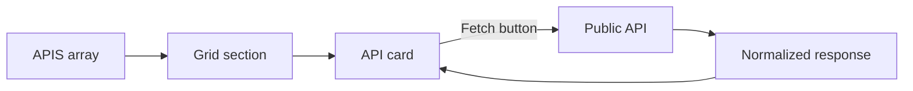

# API Explorer


An animated single-page React application for exploring free public APIs. Each API has its own card that fetches live data on demand and displays the response.

## Overview

API Explorer demonstrates asynchronous data fetching and per-component request state in React, presented through a motion-driven interface. It runs entirely in the browser, with no backend and no API keys.

## Supported APIs

| API | Returns | Endpoint |
| --- | --- | --- |
| [Open Trivia DB](https://opentdb.com) | A multiple-choice trivia question | `opentdb.com/api.php` |
| [Dog CEO](https://dog.ceo/dog-api/) | A random dog image | `dog.ceo/api/breeds/image/random` |
| [Advice Slip](https://api.adviceslip.com) | A random piece of advice | `api.adviceslip.com/advice` |
| [JokeAPI](https://v2.jokeapi.dev) | A joke, with blacklist filters applied | `v2.jokeapi.dev/joke/Any` |

## Key Features

- On-demand data fetching from four public APIs
- Independent idle, loading, success, and error states for each card
- Animated page sections and card interactions using Framer Motion
- Cursor-following glow effect and an animated ticker
- Self-contained design with no backend or API keys

## Technology Stack

| Component | Technology |
| --- | --- |
| UI library | React 19 |
| Build tool | Vite |
| Animation | Framer Motion |
| Data fetching | Browser Fetch API |
| Code quality | ESLint |

## Architecture and Workflow

The API definitions are held in one array, and each entry supplies its own fetch function. The grid renders one card per entry, and each card manages its own request state.



## Project Structure

```text
api_explorer/
├── src/
│   ├── App.jsx         Application, API definitions, and components
│   ├── App.css
│   ├── index.css
│   └── main.jsx
├── index.html
├── package.json
├── vite.config.js
└── README.md
```

## Installation and Setup

### Prerequisites

- Node.js and npm

### Install

```bash
git clone https://github.com/Partha-Shankar/api_explorer.git
cd api_explorer
npm install
```

## Usage

| Command | Purpose |
| --- | --- |
| `npm run dev` | Starts the development server |
| `npm run build` | Creates a production build in `dist` |
| `npm run preview` | Previews the production build |
| `npm run lint` | Runs ESLint |

After starting the development server, open `http://localhost:5173` and select the fetch button on any card. An internet connection is required, and availability depends on each public API.

## Technical Implementation

### Request State

Each `APICard` component tracks its status, data, and error independently, so a slow or failed request affects only that card.

### Adding an API

Add an entry to the `APIS` array in `src/App.jsx`. Each entry defines its display details and an asynchronous `fetch` function that returns the data for the card to show.

## Contributors

Developed by Partha Shankar and Sachin.
